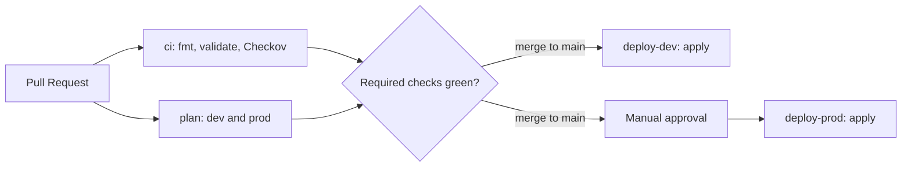

# secure-vault

[](https://github.com/mostaphaabarkan/secure-vault/actions/workflows/ci.yml)
[](https://github.com/mostaphaabarkan/secure-vault/actions/workflows/deploy-dev.yml)
[](https://github.com/mostaphaabarkan/secure-vault/actions/workflows/deploy-prod.yml)

Serverless secure file vault on AWS with malware scanning, encryption (KMS), auto-remediation, cross-region replication and a React dashboard. Built with Terraform and GitHub Actions.

## Terraform

Infrastructure is managed with Terraform (1.10 or later). State is stored remotely in S3 with native locking, one bucket per account. See [ADR 0003](docs/adr/3-terraform-remote-state.md).

### Structure

| Folder                                | Purpose                                                                 |
| ------------------------------------- | ----------------------------------------------------------------------- |
| `infra/bootstrap/`                    | Creates the state bucket in the dev account                             |
| `infra/bootstrap-prod/`               | Creates the state bucket in the prod account                            |
| `infra/envs/dev/`, `infra/envs/prod/` | Per-environment infrastructure: GitHub OIDC provider and pipeline roles |
| `infra/modules/`                      | Reusable modules (empty for now)                                        |

### Prerequisites

- Terraform 1.10 or later
- AWS CLI with SSO profiles `sv-dev` and `sv-prod`
- Python and `pre-commit`

### Run

Sign in first. SSO sessions expire, so repeat this when you see a credentials error:

```powershell
aws sso login --profile sv-dev
aws sso login --profile sv-prod
```

Then run Terraform in each folder. The bootstrap folders set their own profile:

```powershell
terraform -chdir=infra/bootstrap init
terraform -chdir=infra/bootstrap plan

terraform -chdir=infra/bootstrap-prod init
terraform -chdir=infra/bootstrap-prod plan
```

The environment folders do not hard-code a profile, so the same code also runs in GitHub Actions. Select the profile with `AWS_PROFILE`:

```powershell
$env:AWS_PROFILE = "sv-dev"
terraform -chdir=infra/envs/dev init
terraform -chdir=infra/envs/dev plan

$env:AWS_PROFILE = "sv-prod"
terraform -chdir=infra/envs/prod init
terraform -chdir=infra/envs/prod plan
```

### First-time bootstrap

The state bucket cannot store its own state before it exists. On a new account:

1. Create the bucket with local state (no backend block yet).
2. Add the `backend "s3"` block with `use_lockfile = true`.
3. Run `terraform init -migrate-state` to move the local state into the bucket.
4. Delete the local `terraform.tfstate` files.

### Checks before every commit

```powershell
pre-commit install
pre-commit run --all-files
```

Hooks: `terraform fmt`, `terraform validate` and Checkov. Accepted Checkov findings are documented in the code with `#checkov:skip` and listed in ADR 0003.

### Cost and updates

- Resources are tagged with `Project`, `Environment`, `Owner` and `ManagedBy` through `default_tags`.
- Infracost comments the cost estimate on Pull Requests that change `infra/`. It needs the `INFRACOST_API_KEY` repository secret.
- Dependabot checks Terraform providers and GitHub Actions weekly.

## CI/CD

Changes reach AWS only through a Pull Request. GitHub Actions signs in to AWS with OIDC, so no AWS access keys are stored in GitHub.



| Workflow      | Trigger                            | What it does                                                 |
| ------------- | ---------------------------------- | ------------------------------------------------------------ |
| `ci`          | Pull Request, push to `main`       | `terraform fmt`, `terraform validate` and Checkov            |
| `plan`        | Pull Request                       | `terraform plan` for dev and prod, posted as a PR comment    |
| `deploy-dev`  | Push to `main` (`infra/envs/dev`)  | `terraform apply` in the dev account                         |
| `deploy-prod` | Push to `main` (`infra/envs/prod`) | `terraform apply` in the prod account, after manual approval |
| `infracost`   | Pull Request (`infra/`)            | Cost estimate as a PR comment                                |

### Security model

- **OIDC, no keys.** Each account trusts GitHub only for this repository. The plan role is limited to Pull Requests, and the apply role to the matching GitHub Environment.
- **Branch and approval rules.** The `dev` and `prod` Environments only deploy from `main`. `prod` also requires a manual approval, and administrators cannot bypass it.
- **Required checks.** `main` is protected by a ruleset. `terraform`, `checkov`, `plan-dev` and `plan-prod` must pass before a merge.
- **Least privilege.** The plan role is read-only plus the state lock file. The apply role can only read the account and write its own state. It cannot create resources or change IAM yet, so permissions are added per phase.
- **IAM stays manual.** The OIDC provider and pipeline roles are applied from a developer machine with SSO, never from the pipeline.
- **Private by default.** Role ARNs are marked `sensitive`, and plan comments hide 12-digit account IDs.
